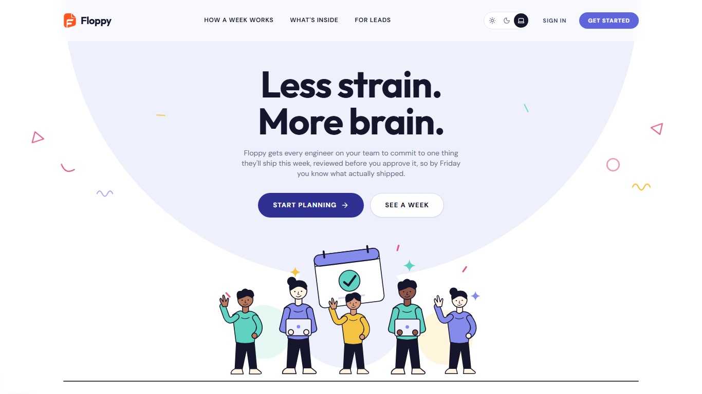

<p align="center"></p>

# Floppy

**Less strain. More brain.** Weekly planning for software teams. Every engineer commits to one thing they'll ship this week, and a lead approves the plan before the week starts. By Friday the team knows what actually shipped.

[](LICENSE)

[](CODE_OF_CONDUCT.md)



Deploy to Heroku: follow [the deployment guide](docs/HEROKU.md) to run the frontend and API together in one app, with config vars and database migrations.

## Features

- **Weekly plans.** One main task with a *why*, sub-goals and go-to-market goals. Drafts are private; submitted plans go to the right lead.
- **Lead approval.** Leads approve a plan or send it back with one comment, and see the whole team's week on one screen.
- **Tasks like Jira.** Keys such as `NORT-42`, types (Task, Bug, Story), story points, labels, an *In review* status and a full activity history on every task.
- **Board and calendar.** Drag tasks between To do, In progress, In review and Done, or across days to move a deadline. A shared filter bar covers search, assignee, type, priority and label.
- **Chat** on every task and plan, a channel per team and direct messages, in realtime.
- **Pages:** a versioned markdown wiki for the project.
- **Notifications** in-app, by email and by SMS, with per-person channel settings and deadline reminders.
- **GitHub issues** linked to tasks, and an optional **AI plan reviewer**.
- **Organizations, teams and roles** (owner, admin, team lead, member), plus a staff console that only ever sees metadata.
- **Light and dark mode**, keyboard support and "reduce motion" throughout. See [ACCESSIBILITY.md](ACCESSIBILITY.md).

## Tech

This is the rebuild of the original FastAPI + TanStack Floppy, on a new stack and with a new design:

| Layer | Tech |
| --- | --- |
| Web | Next.js 15 (App Router), TypeScript, Tailwind CSS v4, Radix primitives, TanStack Query |
| API | Node.js (Express 5, TypeScript), Socket.IO for realtime chat, node-cron for reminders |
| Database | Supabase Postgres via Drizzle ORM (SQL migrations in `apps/api/drizzle`) |
| Auth | Clerk: email + password with email verification, password reset, Google, GitHub, Organizations |
| Notifications | Novu Cloud: `@novu/api` triggers, `@novu/framework` code-first workflows, `@novu/react` Inbox. Email via **Resend**, SMS via **Twilio** |
| Optional | GitHub REST API (Octokit). An AI plan reviewer through any OpenAI-compatible API (Groq or xAI), switched off by default |

```
Floppy/
├─ apps/api        Express API, Drizzle schema + migrations, Novu workflows, jobs, tests
├─ apps/web        Next.js app: landing page, customer app (/app), staff console (/staff)
├─ packages/shared zod schemas, types, constants and week math used by both apps
├─ docs/           Architecture, data model, API, auth/RBAC, workflows, notifications, security, AI, development
└─ ANALYSIS.md     What the original project does (features, data, rules, flows)
```

---

## 1. Requirements

- Node.js **24.x** (`.nvmrc` says 24) and npm 10+.
- Accounts (all have free tiers):
  - [Supabase](https://supabase.com)
  - [Clerk](https://clerk.com)
  - [Novu Cloud](https://novu.co)
  - [Resend](https://resend.com) for email
  - [Twilio](https://twilio.com) for SMS
- Optional: a GitHub token for private repositories, and a Groq or xAI key to switch on AI.

Docker is **not** needed. Tests run Postgres in-process with PGlite.

## 2. Install

```bash
npm install
cp apps/api/.env.example apps/api/.env
cp apps/web/.env.example apps/web/.env.local
```

Fill the two env files as described below. Real secrets never go into the repo: `.gitignore` excludes every `.env` file except the `.env.example` templates.

## 3. Supabase (database)

1. Create a project and note the database password.
2. Go to **Project Settings → Database → Connection string** and copy two URLs into `apps/api/.env`:
   - **Transaction pooler** (port 6543) as `DATABASE_URL`. This is the runtime connection.
   - **Session pooler** or **direct** (port 5432) as `DATABASE_MIGRATION_URL`. Migrations need a session connection.
3. Create the tables:
   ```bash
   npm run db:migrate
   ```
   The second migration turns on **Row Level Security with no policies** for every table. Supabase's `anon` and `authenticated` API keys can read nothing, and only the API's own connection reaches the data.

## 4. Clerk (authentication)

1. Create an application.
2. Under **User & authentication**:
   - Turn on **Email** with **Password**, and verification by **Email code**.
   - Under **SSO connections**, add **Google** and **GitHub**. Development instances use Clerk's shared OAuth credentials, so no setup is needed to try them.
3. **Configure → Organizations:** turn Organizations on. Keep the default roles `org:admin` and `org:member`. Floppy stores the exact role (owner, admin or member) in the membership's public metadata.
4. **Configure → Attack protection:** turn on **user lockout** (brute force) and **bot protection**.
5. **API keys:** copy them into both env files:
   - `apps/api/.env`: `CLERK_SECRET_KEY` and `CLERK_PUBLISHABLE_KEY`.
   - `apps/web/.env.local`: `NEXT_PUBLIC_CLERK_PUBLISHABLE_KEY` and `CLERK_SECRET_KEY`.
6. **Webhooks** (recommended in production; optional locally, because the API lazily syncs users and memberships):
   - Endpoint: `https://<your API>/webhooks/clerk`.
   - Events: `user.*`, `organization.*`, `organizationMembership.*`, `email.created`, `sms.created`.
   - Put the signing secret in `CLERK_WEBHOOK_SIGNING_SECRET`.
7. **Platform staff and super admin:** create these from the command line. They can never be created by signing up.
   ```bash
   npm run superadmin:create -- --email you@company.com --first-name Your --last-name Name
   npm run staff:create      -- --email ops@company.com --first-name Sam --last-name Ops
   ```
   If the email already has an account, it's promoted. Otherwise a password is generated and printed once.

> **Clerk's auth emails through Novu (optional).** By default Clerk sends the verification, password-reset and invitation emails itself. To send them through Novu and Resend instead:
>
> 1. In Clerk → **Customization → Emails**, open *Verification code*, *Reset password code* and *Organization invitation*, and turn off **Delivered by Clerk**.
> 2. Set `CLERK_EMAILS_VIA_NOVU=true`.
> 3. Make sure the webhook above is subscribed to `email.created` and `sms.created`.
>
> This needs a public API URL (deploy, or use a tunnel).

## 5. Novu (notifications: in-app, email, SMS)

1. Create a Novu Cloud account. Go to **Developer → API Keys** and copy:
   - `NOVU_SECRET_KEY` into `apps/api/.env`.
   - `NOVU_APPLICATION_IDENTIFIER` into `apps/api/.env`, and optionally `NEXT_PUBLIC_NOVU_APPLICATION_IDENTIFIER` into `apps/web/.env.local`.
2. **Connect Resend (email).** Integrations → Add → **Resend**. Paste your Resend API key and a *From* address on a domain you've verified in Resend. Mark it primary and active.
3. **Connect Twilio (SMS).** Integrations → Add → **Twilio**. Paste the Account SID, Auth Token and your Twilio *From* number. Mark it active.
   - Twilio trial accounts can only text numbers you've verified in Twilio.
4. **In-App (the bell).** It's on by default. Open the In-App integration and turn on **HMAC encryption**. The API signs each subscriber id with your secret key (`subscriberHash`), so nobody can open someone else's inbox.
5. **Publish the workflows.** The 26 workflows live in code (`apps/api/src/notifications/workflows.ts`) and are served from the API's bridge at `/api/novu`. Novu Cloud must be able to reach it:
   - **Local development:** start the API (`npm run dev:api`), then in another terminal run `npm run novu:dev -w @floppy/api`. This opens a tunnel and Novu's local Studio. From the Studio, **Sync** to your Development environment, or run `npx novu@latest sync --bridge-url <tunnel-url>/api/novu --secret-key $NOVU_SECRET_KEY`.
   - **Deployed:** set `API_PUBLIC_URL` and run `npm run novu:sync -w @floppy/api`.
6. **Check every channel:**
   ```bash
   npm run notify:test -- --user you@company.com
   ```
   This fires the `test-notification` workflow on in-app, email and SMS. SMS is sent if the user saved a phone number under *Settings → Notifications*. The same test is a button on that page. Delivery per channel shows in Novu → **Activity**.

Each user is a Novu **subscriber** (`subscriberId` = Clerk user id). The subscriber is created at sign-up and kept in step with name, email, phone and time zone. On the **Notifications** page people can:

- Switch email, SMS and in-app on or off globally.
- Set each workflow per channel. Security workflows are marked "always on".
- Set their phone number and time zone.
- Choose how early deadline reminders come (1 hour, 1 day or 3 days).

The workflow catalogue is in [docs/NOTIFICATIONS.md](docs/NOTIFICATIONS.md).

## 6. Optional integrations

- **GitHub.** Public repositories work with no setup. For private repositories, or more than 60 GitHub calls an hour, create a fine-grained token with *Issues: read* and *Metadata: read* and set `GITHUB_TOKEN`.
- **AI (on hold).** With `AI_API_KEY` empty, the AI buttons are hidden and the AI endpoints return 503, while planning works normally. To switch it on, set `AI_API_KEY`, `AI_BASE_URL` and `AI_MODEL`:
  - Groq: `https://api.groq.com/openai/v1` with a model such as `openai/gpt-oss-120b`.
  - xAI: `https://api.x.ai/v1` with a model such as `grok-3-mini`.

  See [docs/AI.md](docs/AI.md).

## 7. Run

```bash
npm run dev          # API on http://localhost:4000 and web on http://localhost:3000
# or, in two terminals:
npm run dev:api
npm run dev:web
```

Open http://localhost:3000, click **Get started**, sign up, create an organization and write your first plan.

### Demo data

```bash
# apps/api/.env: DEMO_PASSWORD=<8+ characters>
npm run db:seed              # add -- --reset to rebuild the demo organizations
```

This creates two organizations (Northwind Labs, Harbor Health) with:

- Teams with leads, and a person on two teams.
- Five closed weeks of plans (some shipped, some not), and this week's plans in every state.
- Tom's carried-over billing export.
- Assigned tasks with keys, types, story points and labels: one overdue, one due tomorrow, one in review, one already in a plan.
- A linked public GitHub repository, chat history, versioned pages and synthetic AI usage.

The seed prints the logins. Every account uses `DEMO_PASSWORD`, and in a Clerk development instance any email verification code for these `+clerk_test` addresses is `424242`.

| Who | Email | Where |
| --- | --- | --- |
| Member (Payments) | `marco+clerk_test@example.com` | `/app` |
| Team lead (Payments) | `leila+clerk_test@example.com` | `/app` |
| Org owner (Northwind) | `olivia+clerk_test@example.com` | `/app` |
| Org admin (Northwind) | `arjun+clerk_test@example.com` | `/app` |
| Member with carried-over work | `tom+clerk_test@example.com` | `/app` |
| Owner of Harbor Health | `hana+clerk_test@example.com` | `/app` |
| Platform staff | `staff+clerk_test@example.com` | `/staff` |
| Super admin | `root+clerk_test@example.com` | `/staff/super` |

## 8. Test, typecheck, build

```bash
npm test             # shared + API: 97 tests (tenancy, plan workflow, tasks and issues, chat, pages, super admin, reminders, realtime…)
npm run typecheck
npm run lint
npm run build
```

API tests run against an in-process Postgres (PGlite) with the real migrations applied. Clerk, Novu, GitHub and the AI are replaced by in-memory fakes, so tests need no keys and no network.

## 9. Scripts

| Command | What it does |
| --- | --- |
| `npm run dev` | API + web in watch mode |
| `npm run db:generate` | New SQL migration from `apps/api/src/db/schema.ts` |
| `npm run db:migrate` | Apply migrations to `DATABASE_MIGRATION_URL` (or `DATABASE_URL`) |
| `npm run db:seed` | Demo data (`-- --reset` to rebuild) |
| `npm run staff:create -- --email …` | Create or promote a staff account |
| `npm run superadmin:create -- --email …` | Create or promote a super-admin account |
| `npm run notify:test -- --user <email>` | Send a test notification on every channel |
| `npm run novu:dev -w @floppy/api` | Tunnel the local Novu bridge and open Novu Studio |
| `npm run novu:sync -w @floppy/api` | Publish workflows from `API_PUBLIC_URL` to Novu Cloud |

## 10. Where to look next

- [ANALYSIS.md](ANALYSIS.md): the original project, feature by feature.
- [docs/ARCHITECTURE.md](docs/ARCHITECTURE.md): how the pieces fit.
- [docs/DATA_MODEL.md](docs/DATA_MODEL.md), [docs/API.md](docs/API.md), [docs/AUTH_AND_RBAC.md](docs/AUTH_AND_RBAC.md), [docs/WORKFLOWS.md](docs/WORKFLOWS.md), [docs/NOTIFICATIONS.md](docs/NOTIFICATIONS.md), [docs/SECURITY.md](docs/SECURITY.md), [docs/AI.md](docs/AI.md), [docs/DEVELOPMENT.md](docs/DEVELOPMENT.md).

## 11. Contributing and community

Contributions are welcome. Start with [CONTRIBUTING.md](CONTRIBUTING.md): setup, the rules of the codebase and what a pull request needs.

- [Code of Conduct](CODE_OF_CONDUCT.md): how we treat each other, and how to report a problem.
- [Security policy](SECURITY.md): report vulnerabilities privately, never in a public issue.
- [Accessibility](ACCESSIBILITY.md): what Floppy supports today, known gaps, and how to report a barrier.
- [Issues](https://github.com/Tharinda-Pamindu/Floppy/issues/new/choose): bug reports, feature requests and accessibility issues each have a template.

## 12. License

Copyright (C) 2026 Tharinda Pamindu.

Floppy is free software: you can redistribute it and/or modify it under the terms of the [GNU Affero General Public License v3.0](LICENSE) as published by the Free Software Foundation.

Floppy is distributed in the hope that it will be useful, but WITHOUT ANY WARRANTY; without even the implied warranty of MERCHANTABILITY or FITNESS FOR A PARTICULAR PURPOSE. See the GNU Affero General Public License for more details.

If you run a modified version of Floppy for other people to use over a network, the AGPL requires you to offer them the source code of your version.
