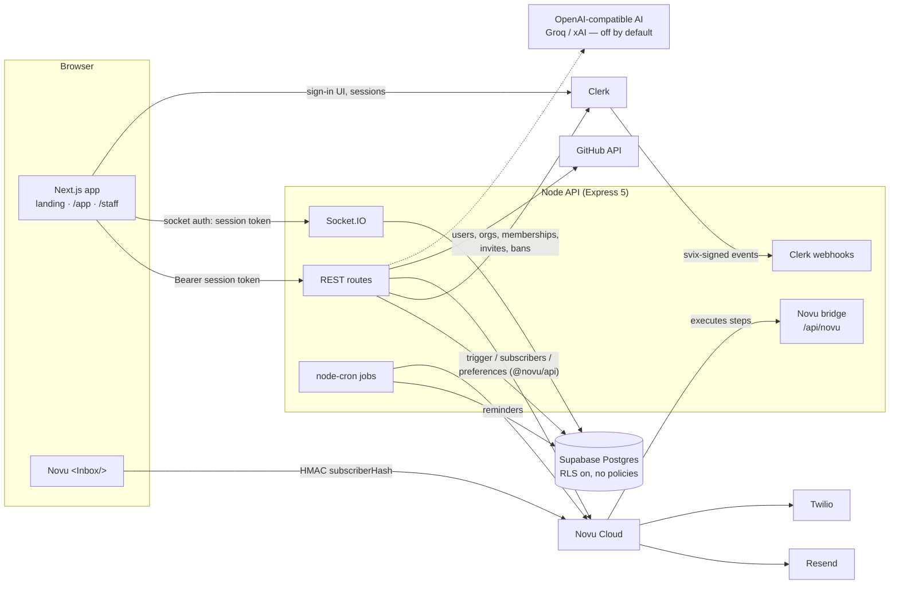

# Architecture

## System overview



- **Web (`apps/web`).** One Next.js 15 App Router app with three areas:
  - The public landing page `/`.
  - The customer app `/app/[orgId]/…`.
  - The staff console `/staff/…`, with the hidden super-admin page `/staff/super`.

  It talks to the API with `fetch` and a Clerk session token in `Authorization: Bearer …`, and never sends cookies to the API.
- **API (`apps/api`).** Express 5 in TypeScript. One process serves:
  - The REST API.
  - Socket.IO for realtime chat.
  - The Novu Framework bridge, which runs the steps of the code-first workflows.
  - Clerk webhooks.
  - The reminder cron.
- **Shared (`packages/shared`).** zod request schemas, response types, enums, limits and week math, used by both apps, so validation rules exist once.
- **Database.** Supabase Postgres, accessed only by the API through Drizzle. Every table has Row Level Security on with no policies, so Supabase's public keys see nothing.
- **Identity.** Clerk owns users, passwords, sessions, social login, email verification, password reset, organizations, memberships and invitations. The API keeps a **mirror** of users, organizations and memberships in Postgres, so it can join them with plans, teams and tasks in SQL.

## Request lifecycle

```mermaid
sequenceDiagram
  participant B as Browser
  participant API as Express
  participant CL as Clerk (JWKS)
  participant DB as Postgres
  B->>API: GET /organizations/:orgId/plans (Bearer token)
  API->>CL: verify session JWT (clerkMiddleware, cached JWKS)
  API->>DB: requireUser → load user mirror (create from Clerk on first sight)
  Note over API: deactivated / banned → 403 ACCOUNT_DISABLED
  API->>DB: orgContext → org + caller's membership
  Note over API: not a member → 404 · suspended → 403 ORGANIZATION_SUSPENDED
  API->>DB: service query, always filtered by organization_id
  API-->>B: JSON (zod-validated input; errors as {error:{code,message}})
```

**Lazy sync.** A user who is missing locally is fetched from Clerk on their first request. A membership that's missing locally, for example right after someone accepts a Clerk invitation, is checked against Clerk once, when the organization exists. So local development works without a public webhook URL, and webhooks keep production in step.

## Folder map

```
apps/api/src
├─ index.ts            wiring: config → adapters → createApp → http server + Socket.IO + cron
├─ app.ts              middleware order: helmet, CORS, webhooks (raw body), JSON, Novu bridge, rate limit, auth, routes
├─ config.ts           zod-validated environment (refuses to start without required secrets)
├─ ports.ts            interfaces for Clerk, Novu, GitHub, AI, realtime (tests use fakes)
├─ adapters/           clerk.ts · novu.ts · github.ts · realtime.ts (Socket.IO)
├─ auth/middleware.ts  requireUser · orgContext (tenancy) · requireStaff · requireSuperadmin
├─ services/           plans · teams · orgs · tasks · repos · chat · pages · ai · platform · superadmin · me · sync · webhooks
├─ routes/             thin HTTP layer: parse with shared zod schemas → call a service
├─ notifications/      workflows.ts (@novu/framework) · catalog.ts · email.ts (escaped HTML layout)
├─ jobs/reminders.ts   weekly + deadline reminders (idempotent through reminder_sends)
├─ ai/                 prompts · zod output schemas · OpenAI-compatible provider
└─ db/                 schema.ts (Drizzle) · client.ts ; SQL migrations in apps/api/drizzle

apps/web/src
├─ middleware.ts       Clerk: /app/** and /staff/** need a session
├─ app/(marketing)     landing page
├─ app/(auth)          sign-in, sign-up, accept-invite (Clerk components)
├─ app/app/...         welcome + [orgId]/{week, plans, approvals, tasks, chat, teams, pages, history, settings, notifications}
├─ app/staff/...       overview, organizations, users, ai-usage, super (server-side role check → 404)
├─ components/         ui/ (Radix-based primitives) · plan/ · tasks/ · chat/ · staff/ · app-shell · notification-bell · realtime
└─ lib/                api.ts (Bearer fetch + typed errors) · queries.ts (TanStack Query) · utils
```

## Key decisions

| # | Decision | Why |
| --- | --- | --- |
| A1 | **Separate Node API** rather than Next.js route handlers | The owner chose this. It keeps realtime, cron and the Novu bridge in one long-running process. |
| A2 | **Clerk Organizations**, with Floppy's own role (owner/admin/member) in membership public metadata | Clerk ships two roles. The owner rules (last-owner guard; admins can't touch owners) are enforced by the API. |
| A3 | **Mirror Clerk data in Postgres** (webhooks + lazy sync) | Tenancy checks and reports need SQL joins. Lazy sync makes local development work without a tunnel. |
| A4 | **Tenancy in one middleware** (`orgContext`); outsiders get **404** | Ids can't be probed. A meta-test checks that every `/organizations/:orgId` route runs it first. |
| A5 | **Composite foreign keys** on `team_memberships` | A database bug still can't put someone into another organization's team. |
| A6 | **Interfaces for every external service** (`ports.ts`) | Services never import an SDK. Tests use fakes and need no keys or network. |
| A7 | **Code-first Novu workflows** served from the API | Workflows are versioned and reviewed with the code. Steps can check live state, for example the approval-overdue workflow skips itself once the plan is decided. |
| A8 | **Reminders by node-cron** plus a `reminder_sends` unique table | No Redis is needed, and every reminder goes out at most once, even with several API instances. |
| A9 | **Socket.IO only pushes**; messages are sent over REST | One write path, so validation, rate limits and notifications live in one place. Joining a room re-checks access exactly like REST. |
| A10 | **Append-only page versions** with optimistic concurrency (`baseVersion` → 409) | History is never rewritten, and two editors can't silently overwrite each other. |
| A11 | **AI behind a provider interface, off by default** | The owner put AI on hold. The rubric, ref mapping, staleness, rate limit and usage log from the original are kept for when it's switched on. |
| A12 | **Staff see metadata only** | The original's privacy rule, extended to chat messages and page content. |
| A13 | **At least one team per organization** | The owner asked for it. The first team is created with the organization, and the last one can't be deleted. |
