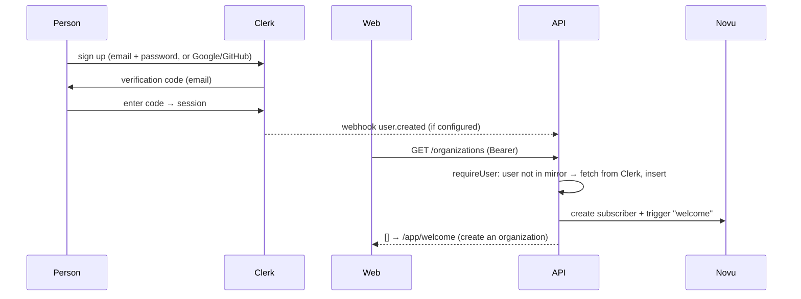

# Authentication and access control

## Authentication (Clerk)

| Feature | How |
| --- | --- |
| Sign up with email + password | Clerk `<SignUp/>` at `/sign-up`. Clerk hashes passwords (bcrypt) and checks them against breach lists. |
| Email verification | Clerk sends a code during sign-up. Optionally delivered through Novu (`auth-verification-code`). |
| Password reset | "Forgot password?" in `<SignIn/>` sends a reset code by email. Optionally through Novu (`auth-password-reset`). |
| Social login | Google and GitHub, configured in the Clerk dashboard |
| Sessions | Short-lived Clerk session JWTs, refreshed by the Clerk frontend SDK. The API verifies them (`clerkMiddleware` with `authorizedParties = [WEB_ORIGIN]`). |
| Brute force | Clerk's user lockout and bot protection (turned on in the dashboard), plus API rate limits |
| Protected pages | `apps/web/src/middleware.ts`: `/app/**` and `/staff/**` need a session. Staff layouts also check the role server-side and return **404**. |
| Protected API | Every route except `/health`, webhooks and the Novu bridge needs a valid token. The user mirror is checked on each request, so a banned account is refused at once even with an unexpired token. |

### Sign-up → first request

### Joining by invitation

An owner or admin invites by email (`POST /organizations/:org/invites`).

1. Clerk emails a link to `/accept-invite?__clerk_ticket=…`.
2. The page shows `<SignUp/>` or `<SignIn/>`, and the ticket adds the membership in Clerk.
3. `/app` reconciles memberships, the person lands in the organization, and owners and admins get `member-joined`.

The invitation is bound to the invited email.

## Roles

| Role | Where it lives | What it is |
| --- | --- | --- |
| `owner` · `admin` · `member` | Clerk membership `publicMetadata.role`, mirrored to `organization_memberships.role` | A **customer** role inside one organization. Clerk's own role is `org:admin` for owner and admin, `org:member` for member. |
| Team lead | `team_memberships.is_lead` | Leads one team (one lead per team) |
| `staff` | Clerk user `publicMetadata.platformRole`, mirrored to `users.platform_role` | **Platform** staff: the staff console. Created only by the CLI or a super admin. |
| `superadmin` | Same | Staff, plus the hidden `/staff/super`. Created **only** by the CLI. |

`publicMetadata` can only be written by the backend, so nobody can make themselves staff from the browser.

## Permission matrix (within one organization)

| Action | Owner | Admin | Team lead | Member | Staff |
| --- | --- | --- | --- | --- | --- |
| View org, members, teams | ✓ | ✓ | ✓ | ✓ | metadata via `/staff` |
| Rename org, invite | ✓ | ✓ (admin or member invites) | | | |
| Change a role / remove someone | anyone except self (last-owner guard) | admins and members / members only | | | |
| Create, rename or delete teams; set the lead | ✓ | ✓ | | | |
| Link GitHub repositories | ✓ | ✓ | own team | | |
| Write, submit and close own plan | ✓ | ✓ | ✓ | ✓ | |
| Read someone's submitted plan | if the author is a lead | if the author is a lead | members of their teams | | |
| Read someone's draft | | | status only | | |
| Approve / send back | leads' plans | leads' plans | members of their teams, never self | | |
| Team week and history | all teams | all teams | own team | | |
| Assign tasks | anyone in org | anyone in org | members of their teams | | |
| Edit or cancel a task | ✓ | ✓ | tasks of their team | the assigner | |
| Change task status | ✓ | ✓ | team tasks | own assigned tasks | |
| Create or edit pages | all pages | all pages | own team's pages | read only | |
| Request org deletion | ✓ | | | | |
| Suspend org, deactivate customers, AI usage | | | | | ✓ |
| Deactivate owners or staff; create staff; decide deletions | | | | | super admin only |

## Hidden super-admin page

- The link is rendered only for `platformRole === "superadmin"`.
- `/staff/super` has a server layout that calls `notFound()` for anyone else.
- Every `/staff/super/*` API route answers **404** (not 403) to anyone else, staff included.
- Every action is written to `admin_audit_log`.
