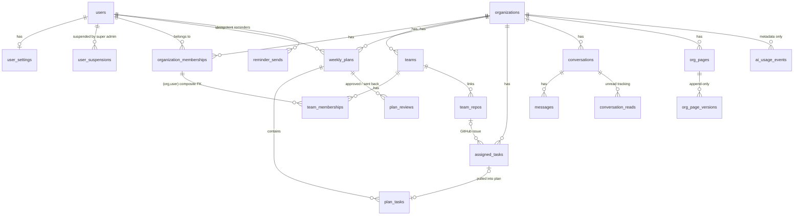

# Data model

Supabase Postgres, defined in `apps/api/src/db/schema.ts` (Drizzle). Migrations are generated into `apps/api/drizzle/`.

- Users and organizations use their **Clerk ids** (text) as primary keys. Everything else uses UUIDs.
- Enum-like columns are `text` with a `CHECK`.
- Row Level Security is on for every table, with no policies (migration `0001_enable_rls`).

## Tables

| Table | Purpose | Key constraints |
| --- | --- | --- |
| `users` | Mirror of the Clerk user | `platform_role IN (none, staff, superadmin)`. `is_active=false` when banned in Clerk. |
| `user_settings` | Time zone, phone (SMS), deadline lead time | `deadline_lead IN (1h, 1d, 3d)` |
| `user_suspensions` | Owner-account suspensions by a super admin | Partial unique: one open suspension per user |
| `organizations` | Mirror of the Clerk organization, plus staff suspension | |
| `organization_memberships` | Mirror of the Clerk membership with Floppy's role | `UNIQUE(org, user)`, `role IN (owner, admin, member)` |
| `teams` | Teams inside an organization (at least one each) | `UNIQUE(org, name)`, `UNIQUE(org, id)` as the composite FK target |
| `team_memberships` | Who is on a team, and the lead | `UNIQUE(team, user)`. **Partial unique: one lead per team.** Composite FKs `(org, team) → teams` and `(org, user) → organization_memberships`, both `ON DELETE CASCADE`. |
| `team_repos` | GitHub repositories linked to a team | `UNIQUE(team, owner, name)` |
| `weekly_plans` | One plan per person, per org, per week | `UNIQUE(org, user, week_start)`. **`CHECK ISODOW(week_start)=1`** (Mondays only). `status IN (draft, submitted, approved, done)`. Holds the AI review as JSONB plus a content hash for staleness. |
| `plan_tasks` | Tasks of a plan | **Partial unique: one `main` per plan.** `estimate_hours BETWEEN 1 AND 60`. `why` only on the main task. A unique link to `assigned_tasks`. |
| `plan_reviews` | Approve / send back, with comments | `action IN (approved, changes_requested)` |
| `assigned_tasks` | Work assigned with a deadline and priority | `status IN (todo, in_progress, done, cancelled)`, `priority IN (low, normal, high, urgent)`, a partial index on open deadlines |
| `conversations` | Task thread, plan thread, team channel or DM | `CHECK`: the target column matches the kind. Unique per task, plan, team, and per `(org, dm_key)`. |
| `conversation_reads` | Last-read timestamp per person, for unread counts | PK `(conversation, user)` |
| `messages` | Plain-text messages, mention ids, soft delete | Index `(conversation, created_at)` |
| `org_pages` | Wiki pages (org-wide or team), one level of nesting | `UNIQUE(org, slug)`. `current_version` is used for optimistic locking. |
| `org_page_versions` | Every saved version, never updated | `UNIQUE(page, version)` |
| `ai_usage_events` | One row per AI call (no prompt or output text) | `operation`/`outcome` CHECKs and indexes for the staff reports |
| `reminder_sends` | Reminders already sent | `UNIQUE(user, kind, ref)`, which makes the cron idempotent |
| `org_deletion_requests` | Owner asks, super admin decides | Partial unique: one pending request per org. No FK, so the record survives the deletion. |
| `admin_audit_log` | Every staff and super-admin action | |

## Tenancy guarantees

1. Every org-scoped route resolves the caller's membership first (`orgContext`). Non-members get **404**.
2. Every service query filters by `organization_id`. A foreign id inside your own org URL is simply not found.
3. The database itself rejects cross-org team membership through the composite FKs.
4. Deleting an organization cascades to every tenant table. A test checks that nothing remains.
5. Plans belong to the person and the organization, not to a team, so history survives team changes, just as in the original.
