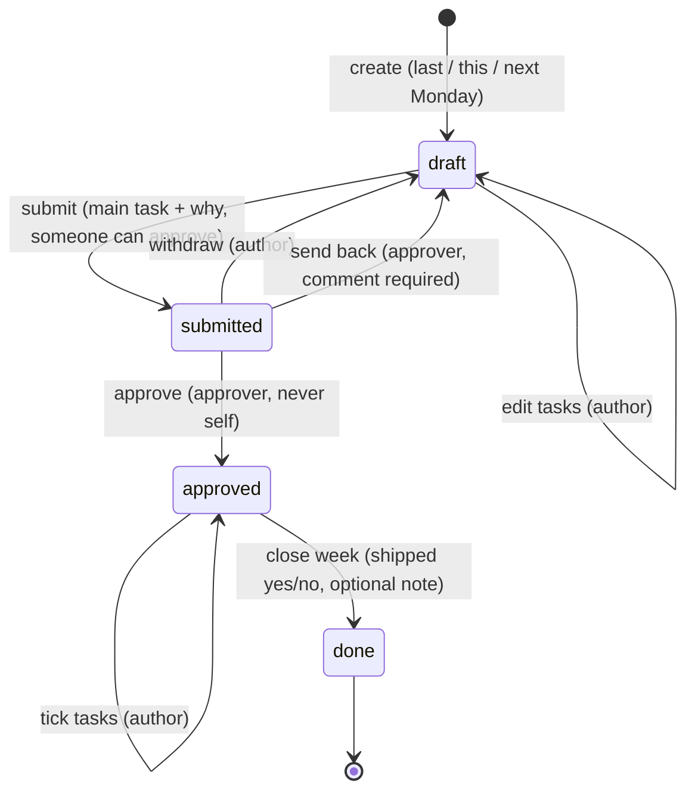
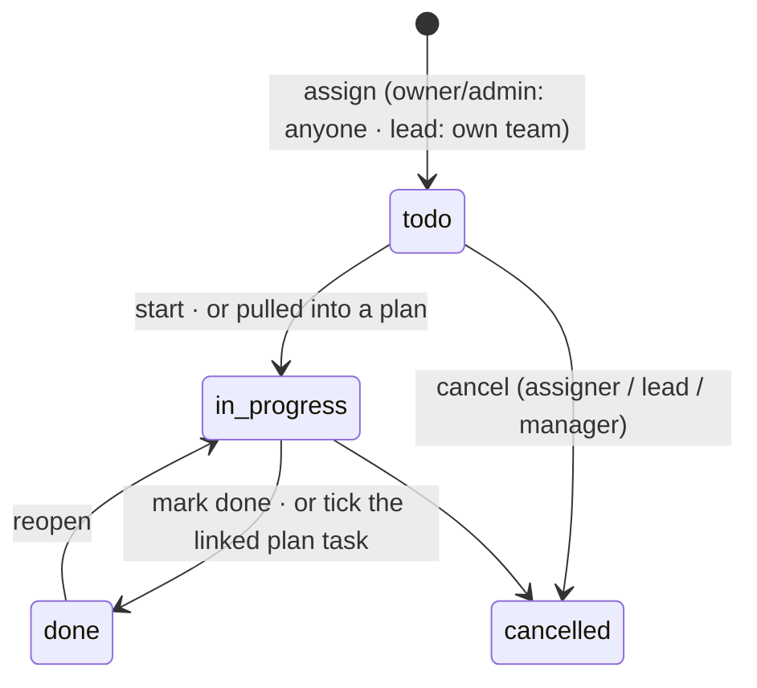
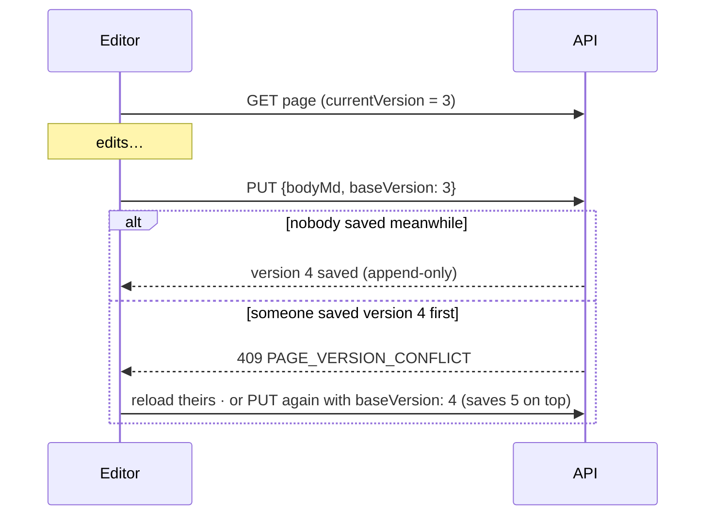

# Workflows and business rules

## Weekly plan lifecycle



- A plan has at most **15 tasks** and exactly **one main task** (enforced by a database index). Only the main task has a "why". Estimates are 1–60 hours, and the editor warns above 30.
- **Who approves:**
  - A lead of a team the author is on can approve, but never their own plan.
  - A lead's own plan can also be approved by another lead of a shared team, or by an owner or admin.
  - With no possible approver, submitting answers `409 NO_APPROVER`.
- **Privacy:** drafts are visible only to the author. Others see "still drafting" in the team week. Submitted plans are readable by possible approvers.
- **Notifications:**
  - Submit sends `plan-submitted` to the approvers (in-app now, email digested over 30 minutes) and `approval-overdue`, which waits 24 hours and skips itself if the plan has been decided.
  - Approve sends `plan-approved`.
  - Send back sends `plan-changes-requested`.
  - Monday 09:00 and Friday 16:00 reminders go out in each person's time zone.

## Assigned task lifecycle



- **Assigning** notifies the assignee (`task-assigned`: email and in-app, SMS optional) with the deadline, priority and GitHub link.
- **Pulling into a plan** adds a linked plan task to the assignee's draft for that week, creating the draft if needed.
  - Ticking the plan task done completes the assigned task, and the assigner gets `task-completed`.
  - Completing the assigned task ticks the plan task, **only if the plan is approved**, so the plan rules still hold.
- **Deadlines:** the cron sends `task-deadline-reminder` when the deadline minus the assignee's lead time (1 hour, 1 day or 3 days) has passed, and `task-overdue` to the assignee and assigner once the deadline passes.
  - Each reminder is keyed on the task **and its deadline**, so moving the deadline re-arms it.
- **Reassigning** removes the link to the previous person's plan and sends the new assignee `task-assigned`.

## Teams

- Creating an organization creates its first team, with a name chosen at that step (default "Core team"). The creator is on it but isn't the lead.
- The **last team can't be deleted** (`409 LAST_TEAM`).
- Deleting another team keeps its plans, tasks and pages. Team pages become organization-wide, and tasks lose their team link.
- Setting a new lead replaces the old one in one transaction, and the new lead gets `team-lead-assigned`.

## Pages (wiki)



- An import is the same as a save, using the file's text.
- An export downloads any version's exact text.

## Chat

- **Who can read and post:**
  - Team channels: team members and managers.
  - DMs: the two people.
  - Task threads: assignee, assigner, team lead and managers.
  - Plan threads: whoever can read the plan.
- **Sending:** messages are sent over REST and pushed with Socket.IO.
  - Recipients get `chat-message`: in-app now, email digested over 15 minutes.
  - Mentioned people (`<@userId>`, which must be conversation members) get `chat-mention` straight away.
- **Unread counts** come from `conversation_reads.last_read_at`.

## Organization deletion

```mermaid
sequenceDiagram
  participant O as Owner
  participant A as API
  participant S as Super admin
  O->>A: POST /organizations/:id/deletion-request {reason}
  A-->>S: org-deletion-requested (in-app + email)
  Note over A: org keeps working; one pending request per org; owner may cancel
  S->>A: decision approve
  A->>A: delete in Clerk, then DELETE organization (cascades everything)
  A-->>O: org-deletion-decided (approved)
  Note over S,A: or reject (note required) → owner told why
```

## Suspensions

- **Organization** (staff): every member gets `403 ORGANIZATION_SUSPENDED` until it's reinstated, and members are notified.
- **Owner account** (super admin): banned in Clerk, so sessions end and sign-in is blocked. The owner is told by email, and reinstating reverses it.
